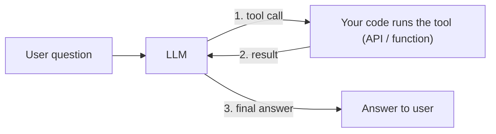
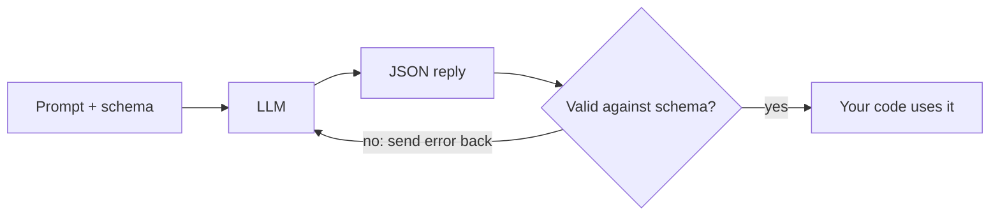
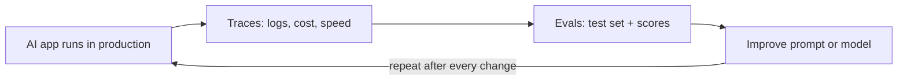
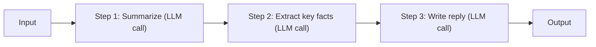
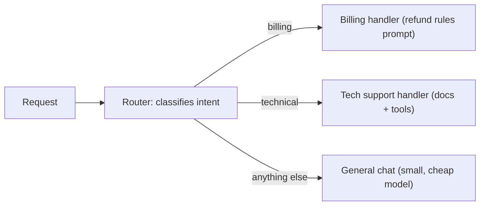

# Core Design Patterns for AI Engineers

*A beginner-friendly guide to five patterns that show up in almost every production LLM application.*

---

## Contents

1. [Tool use (function calling)](#1-tool-use-function-calling)
2. [Structured output](#2-structured-output)
3. [Evals and observability](#3-evals-and-observability)
4. [Prompt chaining](#4-prompt-chaining)
5. [Routing](#5-routing)
6. [How the patterns fit together](#6-how-the-patterns-fit-together)
7. [Quick reference](#7-quick-reference)

---

## 1. Tool use (function calling)

### Definition
Tool use lets a language model request that your code run a function, such as an API call or a database query, and then use the result in its answer.

### Why it matters
An LLM only produces text. It cannot check live data, read your database or take actions. Tool use is what turns a chatbot into an assistant that can actually do things, and it is the foundation of almost every AI agent.

### How it works
You describe a set of tools (name, purpose, parameters). The model decides whether a tool is needed and replies with a tool call. **The model never runs the tool itself.** Your code executes it and sends the result back, and the model then writes the final answer.



### Example
> **User:** "Will I need an umbrella in Hyderabad today?"
> **LLM:** requests `get_weather(city="Hyderabad")`
> **Your code:** calls the weather API and returns `{"rain_chance": 80}`
> **LLM:** "Yes, there is an 80% chance of rain, so take an umbrella."

### Best practices
- Write clear tool names and descriptions. The model chooses tools by reading them.
- Validate every argument the model sends before executing anything.
- Require human approval for risky actions such as deleting data or moving money.

### Common pitfalls
- Giving the model too many tools at once, which leads to wrong choices.
- Trusting tool arguments blindly, which creates security risks.

---

## 2. Structured output

### Definition
Structured output makes the model reply in a fixed, machine-readable format, usually JSON that follows a schema you define.

### Why it matters
Free-form text is hard for software to use. If another program consumes the model's answer, you need predictable fields, not paragraphs.

### How it works
You pass a schema along with the prompt. The model returns JSON that matches it, and your code validates the result. If validation fails, you send the error back and retry.



### Example
Extracting details from a support email:

```json
{
  "customer_name": "Asha Rao",
  "issue_type": "billing",
  "priority": "high"
}
```

### Best practices
- Use your provider's built-in schema or JSON mode where available. It is more reliable than asking in the prompt.
- Validate with a schema library (for example Pydantic in Python) and retry on failure.
- Keep schemas small and use enums for fixed choices.

### Common pitfalls
- Overly large schemas, which increase errors.
- Skipping validation because the output "usually looks right".

---

## 3. Evals and observability

### Definition
- **Observability** means recording every run: prompt, response, token usage, cost and latency.
- **Evals** are automated tests that score output quality on a fixed set of examples.

### Why it matters
AI output varies from run to run. Without measurement you cannot tell whether a prompt change, a new model or a new feature made things better or worse.

### How it works
Log every run as a trace. Build a test set of real examples with expected qualities, score the app against it, then use the results to improve and score again.



### Example
A support bot has 30 saved questions. After editing the prompt, you rerun all 30 and see accuracy move from 22/30 to 27/30, with no change in cost. You keep the edit.

### Best practices
- Start with 20 to 50 real examples, even before launch.
- Include tricky and failure cases, not only easy ones.
- Track cost and latency alongside quality.
- Use an LLM as a judge if helpful, but spot-check its grading by hand.

### Common pitfalls
- Judging quality by trying a few prompts manually.
- Letting the test set go stale as real usage changes.

---

## 4. Prompt chaining

### Definition
Prompt chaining splits a complex task into a sequence of small LLM calls, where each call's output feeds the next.

### Why it matters
One giant prompt that does everything is hard to write, test and debug. Small steps with one job each are more accurate and easier to improve individually.

### How it works
Each step has a narrow instruction. You can inspect or validate the output between steps before passing it on.



### Example
Turning a long customer email into a response: summarize the email, extract the order number and complaint, then draft a polite reply using only those facts.

### Best practices
- Give each step one clear responsibility.
- Add simple checks between steps to catch errors early.
- Chain only when a single prompt is not good enough.

### Common pitfalls
- Errors compound: a bad step 1 corrupts steps 2 and 3.
- Each extra call adds cost and latency.

---

## 5. Routing

### Definition
Routing classifies an incoming request and sends it to the most suitable prompt, tool or model.

### Why it matters
Different requests need different handling. Routing improves quality by using specialised prompts, and cuts cost by sending easy requests to small, cheap models.

### How it works
A router (often a small LLM call or a simple classifier) labels the request. Your code then dispatches it to the matching handler, with a default route for unclear cases.



### Example
"Why was I charged twice?" is routed to the billing handler. "What is your return window?" goes to the general handler on a cheaper model.

### Best practices
- Always include a sensible default route.
- Test the router separately with evals (pattern 3).
- Start with a few clear categories and expand only when needed.

### Common pitfalls
- Too many overlapping routes that are hard to maintain.
- A misrouted request that silently produces a poor answer.

---

## 6. How the patterns fit together

Real applications combine these patterns. A router picks the right path, a chain breaks the work into steps, tools fetch live data, structured output keeps every step machine-readable, and evals with observability confirm that the whole system works.

---

## 7. Quick reference

| Pattern | Core idea | Use it when | Main risk |
|---------|-----------|-------------|-----------|
| Tool use | The LLM asks, your code acts | You need live data or actions | Unvalidated tool arguments |
| Structured output | Fixed schema, usually JSON | Code consumes the answer | Skipping validation |
| Evals and observability | Log everything, test every change | Always | Stale or too-easy test sets |
| Prompt chaining | Small steps, one job each | A task has clear stages | Compounding errors, extra cost |
| Routing | Classify, then dispatch | Requests vary in type or difficulty | Misrouting, too many routes |
