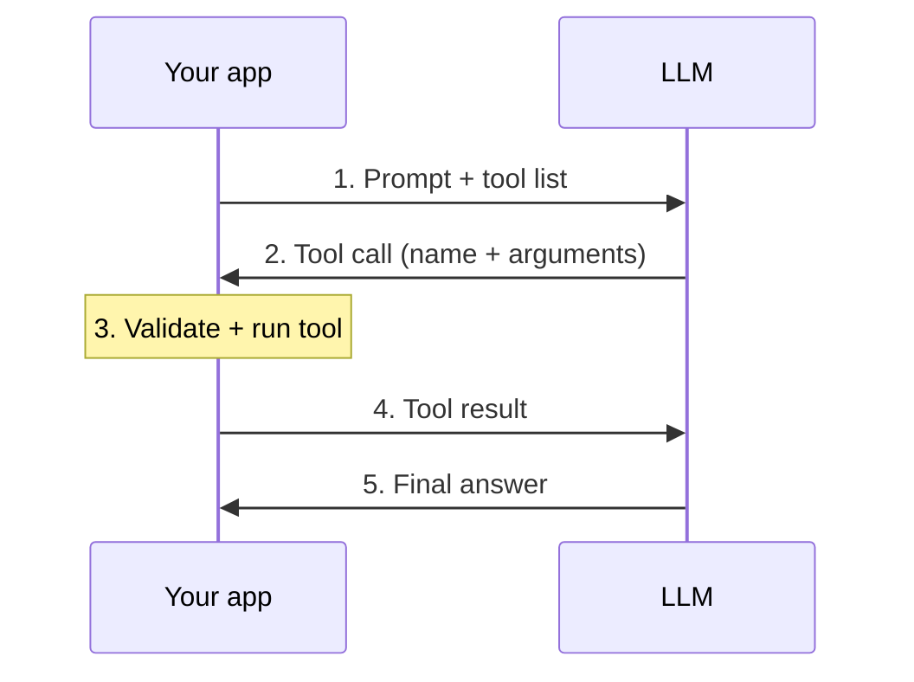
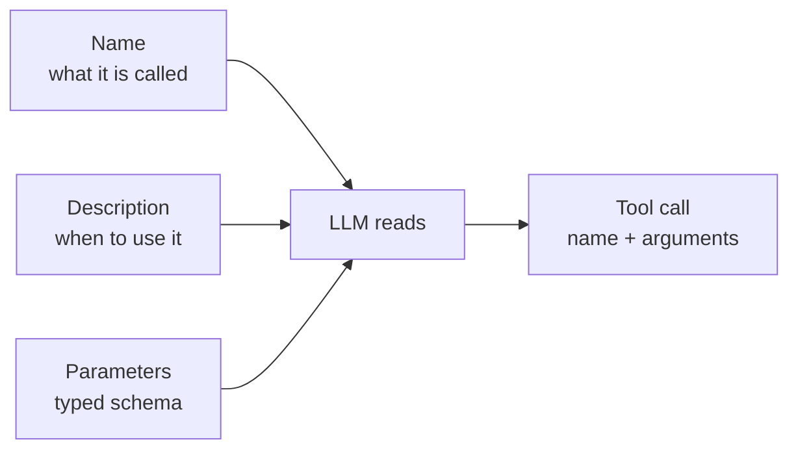
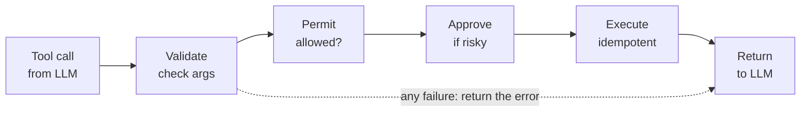
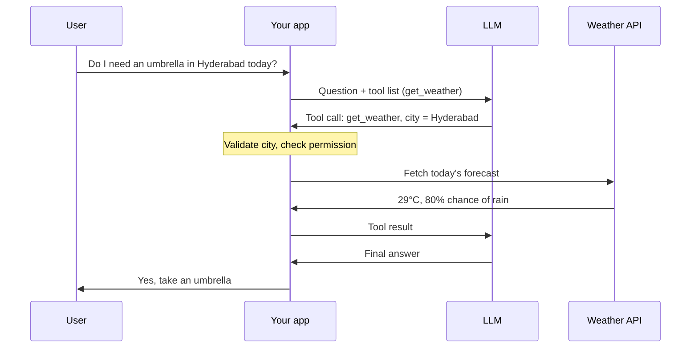

# Function Calling

*Concepts and interview notes: a visual guide*

---

## 1. The loop

- The model only **requests** the call (step 2). Your app does the work (step 3).
- Steps 2 to 4 can repeat before the final answer.

---

## 2. How the model picks a tool

- Vague description: wrong or missed tool.
- Clear description: reliable tool choice.

---

## 3. The safety pipeline

- Treat model-generated arguments and tool output as **untrusted input**.

---

## 4. Real-world example: a weather assistant

A user asks: *"Do I need an umbrella in Hyderabad today?"*

How it maps to the earlier sections:

- **The loop (1):** the LLM never calls the weather service itself. It asks, your app fetches, and the LLM turns the data into a plain answer.
- **Tool choice (2):** the tool is named `get_weather` with the description "use for questions about temperature or rain". That description is why the model picks it for an umbrella question.
- **Safety (3):** your app checks that the city is valid before calling the API. The tool is read-only, so no approval step is needed. A tool like "send a weather alert email" would need one.

---

## 5. Most-asked interview questions

**1. What is function calling, and how does it enable agents?**
The model asks for a specific function to run with specific arguments instead of only writing text. This lets an LLM take real actions and is the core mechanism behind most agents.

**2. Function calling vs structured output?**
Structured output shapes the reply so code can parse it. Function calling requests an action. Both use schemas, which is why they are easy to confuse.

**3. How do you design a tool for an agent?**
A common exercise gives you a bare `issue_refund` tool and asks you to rewrite it so an agent can use it safely. Strong answers cover a clear name, a "when to use" description, typed parameters, a narrow scope, and informative error messages.

**4. The tool call timed out. Did the action happen? What if it runs twice?**
You cannot assume either way. Use idempotency keys so repeats are harmless, and check status before retrying.

**5. How do you stop agent loops (same tool called repeatedly)?**
Cap the iterations, detect repeated identical calls, define clear stop rules, and escalate to a human.

**6. Workflow vs agent?**
A workflow follows a fixed code path. An agent lets the model choose the steps. Prefer a workflow when the steps are known.

**7. MCP vs function calling?**
Function calling is the mechanism inside one app. MCP (Model Context Protocol) is an open standard, introduced by Anthropic in November 2024, that reduces custom integrations between every AI app and every tool.

**8. How do you secure tool use?**
Main risks are access control, PII leakage, prompt injection, and unsafe actions. Tools that send emails, update records or delete data need user approval. Add least-privilege access and treat tool output as untrusted.

**9. How do you evaluate tool calling?**
Check tool choice, argument correctness, and cases where no tool should be called. Also track latency, cost per task, tool-error rate and retry count. One guide calls evals the biggest differentiator between offers and rejections.

**10. What can go wrong with function calling?**
The model may call a tool it did not need, pass wrong arguments, pick the wrong tool, or loop. Fixes: clearer descriptions, validation, loop caps, and evals.
